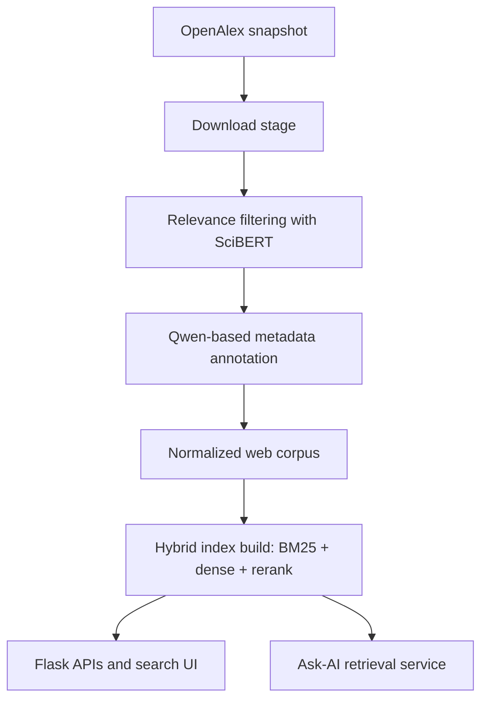

# Architecture

## Overview

AniSpeakArchive is organized as a staged NLP and retrieval system. The repository implementation follows a clear pipeline from raw scholarly records to a searchable web application.

## Components

### 1. Data ingestion

The pipeline entrypoint in [pipeline.py](../pipeline.py) coordinates the stages. The download stage uses [pipeline_scripts/download_snapshot.py](../pipeline_scripts/download_snapshot.py) to pull OpenAlex snapshot partitions into the local data directory.

### 2. Relevance filtering

The BERT filtering stage uses [pipeline_scripts/filter_bert.py](../pipeline_scripts/filter_bert.py) and the training configuration in [configs/bert_classifier.yaml](../configs/bert_classifier.yaml). This stage reduces the full snapshot to papers that are likely relevant to the animal communication domain.

### 3. Annotation and enrichment

The Qwen annotation stage in [pipeline_scripts/annotate_qwen.py](../pipeline_scripts/annotate_qwen.py) enriches retained papers with metadata such as species, stages, features, modalities, and domains.

### 4. Indexing and retrieval

The final corpus is converted into a search-ready format and indexed with hybrid retrieval. The retrieval implementation lives in [anispeakarchive/index/hybrid.py](../anispeakarchive/index/hybrid.py), with dense embeddings in [anispeakarchive/index/dense.py](../anispeakarchive/index/dense.py) and reranking in [anispeakarchive/index/rerank.py](../anispeakarchive/index/rerank.py).

### 5. Application layer

The Flask app in [app.py](../app.py) wires the search service, the Ask-AI service, and the HTTP routes. The app exposes paper search, faceted browsing, auth, bookmarks, citations, and answer generation.

## Design tradeoffs

- The pipeline favors resumability and staged execution over a single monolithic job.
- The retrieval stack combines lexical and dense signals so that exact terminology and semantic similarity both contribute to ranking.
- The project is designed to run on GPU hardware for embeddings and reranking, but the code also contains fallback logic for CPU execution where possible.
- The Ask-AI experience is grounded in retrieved records rather than free-form external knowledge, which is a useful constraint for trustworthy retrieval.
